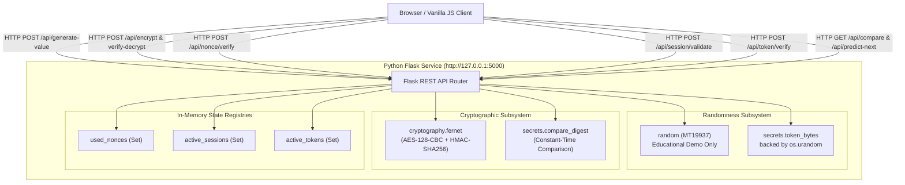
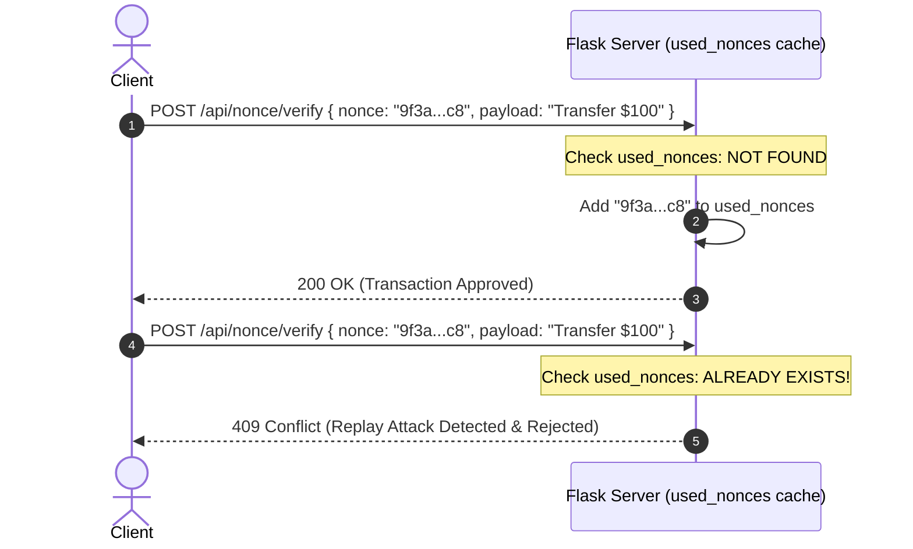

# Secure Random Generator

> An interactive cryptography security laboratory demonstrating why predictable randomness fails in security—and how CSPRNGs provide cryptographically secure random values.

[](https://www.python.org/)
[](https://flask.palletsprojects.com/)
[](https://cryptography.io/)
[](https://developer.mozilla.org/en-US/docs/Web/JavaScript)
[](LICENSE)

[Project Overview](#project-overview) • [Architecture](#system-architecture) • [Cryptographic Primitives](#cryptographic-primitives) • [Attack Demonstrations](#interactive-demonstrations) • [Local Setup](#local-setup) • [Learning Path](#recommended-learning-path)

---

## Visual Overview

```
+----------------------------------------------------------------------------------------------------+
|  STUDIO: Generator Controls                     |  SANDBOX: Live Application & Verification         |
|  [Key (32B)] [Nonce (12B)] [Session] [Token]    |  Demo: AES-128-CBC + HMAC-SHA256 (Fernet)         |
|                                                 |                                                  |
|  Byte Length: [ 32 Bytes (256 Bits)          ]  |  Plaintext: [ Hello, secret cryptographic msg. ] |
|  Formula: 32 Bytes = 256 Bits = 64 Hex Chars    |  [ Encrypt Message with Generated Key ]          |
|                                                 |                                                  |
|  [ 🔐 Generate Secure Value ]                   |  Ciphertext: gAAAAABl...                         |
|  Value: e4f901c8a14b72dc039...                  |  Decryption Attempt: [ e4f901c8a14b... ]         |
|  Status: CSPRNG (OS Kernel Entropy)             |  Outcome: ✓ KEY VERIFIED (HMAC Tag Matched)      |
+----------------------------------------------------------------------------------------------------+
```

---

## Project Overview

Modern information security relies fundamentally on secrets that an adversary cannot guess, compute, or reconstruct. If an attacker can deduce the internal state of a random number generator, every protocol relying on that randomness—whether symmetric encryption keys, authentication tokens, nonces, or session cookies—collapses simultaneously.

**Secure Random Generator** is an interactive, browser-based cryptography learning laboratory built to demonstrate the crucial difference between:

1. **Ordinary Pseudo-Random Number Generators (PRNGs)**:
   Algorithms such as the Mersenne Twister (`MT19937` in Python's standard `random` module) designed for speed, statistical uniformity, and simulation. They are completely deterministic and seed-dependent. If an observer collects 624 32-bit outputs, the internal state can be completely reconstructed, allowing all past and future outputs to be calculated.
2. **Cryptographically Secure Pseudo-Random Number Generators (CSPRNGs)**:
   Algorithms backed by operating-system kernel entropy pools (via Python's `secrets` module and `os.urandom`). CSPRNGs satisfy the **Next-Bit Unpredictability** condition: even with unbounded computing time up to practical cryptographic limits, observing prior sequence outputs grants no polynomial-time advantage in predicting the subsequent bit.

This laboratory turns abstract mathematical security concepts into observable, interactive experiments through live client-server simulations.

---

## Product Experience

The laboratory is structured as an interactive **Two-Column Workbench**:

```
                 SECURE RANDOM GENERATOR WORKBENCH
                                 │
            ┌────────────────────┴────────────────────┐
            │                                         │
   1. GENERATOR STUDIO                      2. INTERACTIVE SANDBOX
  (Generation & Config)                     (Attacks & Verification)
            │                                         │
    ┌───────┼───────┐                         ┌───────┼───────┐
    │       │       │                         │       │       │
  Keys   Nonces  Sessions & Tokens         Fernet  Replay  Timing
                                          Decrypt  Attack  Defense
```

* **Left Column — Generator Studio**:
  The user chooses a cryptographic primitive (Symmetric Key, Nonce, Session ID, or Security Token), selects valid byte lengths (e.g., 16, 24, 32, or 64 bytes), observes real-time bit/hex conversions, and pulls secure entropy from the backend API.
* **Right Column — Interactive Sandbox**:
  The generated entropy is directly coupled to an active security scenario. Users run live operations including authenticated encryption/decryption, stateful replay attack detection, session impersonation tests, and constant-time token comparisons.

---

## Core Features

* **CSPRNG Entropy Generation**: Generates 128-bit, 192-bit, 256-bit, and 512-bit values backed by kernel entropy sources via Python's `secrets` module.
* **Side-by-Side PRNG vs. CSPRNG Engine**: Compares deterministic, seeded PRNG runs against non-deterministic CSPRNG output streams in real time.
* **PRNG Predictability Demonstrator**: Step-by-step interactive disclosure showing how a fixed seed in `MT19937` produces an entirely predictable sequence.
* **Cryptographic Key & Fernet Sandbox**: Symmetric encryption combining AES-128-CBC with HMAC-SHA256 authentication. Users test valid keys, deliberate wrong keys, and corrupted ciphertexts to observe cryptographic authentication failures.
* **Stateful Anti-Replay Nonce Sandbox**: Server maintains a stateful verification registry (`used_nonces`). Shows why fresh requests succeed (`200 OK`) while duplicated requests trigger replay warnings (`409 Conflict`).
* **Session Identifier Authentication**: Validates 256-bit session tokens against active in-memory sessions, illustrating why large entropy spaces ($2^{256}$) defeat brute-force session guessing.
* **Constant-Time Token Verification**: Demonstrates timing attack mitigation using Python's `secrets.compare_digest` to validate tokens without early-exit character-matching side channels.

---

## System Architecture

The project employs a clean client-server architecture: a responsive, zero-dependency Vanilla JavaScript client paired with a lightweight Python Flask cryptographic service.



---

## Tech Stack

| Layer | Technology | Purpose |
| :--- | :--- | :--- |
| **Backend Runtime** | Python 3.9+ | Server environment and standard library integration |
| **Web Framework** | Flask | RESTful JSON API routes and static asset serving |
| **CORS Middleware** | Flask-CORS | Cross-origin resource sharing for decoupled development |
| **Cryptographic Primitives** | `cryptography` (pyca) | Fernet authenticated symmetric encryption (AES + HMAC) |
| **Secure Randomness** | `secrets` / `os.urandom` | OS kernel entropy collection for CSPRNG operations |
| **Constant-Time Verification** | `secrets.compare_digest` | Mitigation of string comparison timing side-channels |
| **Educational PRNG Demo** | `random` (MT19937) | Controlled deterministic predictability demonstration |
| **Frontend Markup** | HTML5 | Accessible, semantic layout with ARIA landmarks |
| **Styling** | Custom CSS3 | Custom property design system, CSS Grid/Flexbox |
| **Client Controller** | Vanilla ES6+ JavaScript | Dynamic configuration, API client, DOM manipulation |
| **Dev Orchestration** | npm / `concurrently` | Concurrent execution of backend and frontend servers |

---

## Cryptographic Primitives

The laboratory models four standard security primitives, detailing their entropy requirements and deployment roles:

| Primitive | Supported Sizes | Default / Recommended | Purpose | Interactive Lab Simulation |
| :--- | :--- | :--- | :--- | :--- |
| **Cryptographic Key** (🔑) | 16, 24, 32 bytes | **32 bytes (256 bits)** | Protects confidentiality and integrity in symmetric encryption. | Encrypt plaintext with Fernet; supply correct key vs. corrupted key to test HMAC verification. |
| **Nonce** (🔄) | 8, 12, 16 bytes | **12 bytes (96 bits)** | Ensures single-use uniqueness across cryptographic operations. | Transmit transaction packet; subsequent submission with the identical nonce triggers replay rejection. |
| **Session ID** (👤) | 16, 32, 64 bytes | **32 bytes (256 bits)** | Binds incoming requests to an authenticated user session. | Authenticate user against active session table; attempt access with a randomly guessed ID. |
| **Security Token** (🛡️) | 16, 32, 64 bytes | **32 bytes (256 bits)** | Unpredictable bearer token for CSRF, password resets, or API access. | Validate token equality via constant-time comparison; mutate individual characters to observe mismatch detection. |

### Technical Details

* **Cryptographic Keys**: A 256-bit symmetric key provides a search space of $2^{256} \approx 1.15 \times 10^{77}$ possible combinations, rendering brute-force enumeration computationally infeasible under known physical computational bounds.
* **Nonces**: In modern authenticated cipher schemes like AES-GCM or ChaCha20-Poly1305, 12-byte (96-bit) nonces are standard. Reusing a nonce with the same key breaks the authenticity guarantee and can expose plaintext relationships.
* **Session Identifiers**: Using high-entropy 256-bit strings eliminates collision probabilities and makes online guessing attacks practically impossible.
* **Security Tokens**: Bearer tokens require unguessable entropy and must be evaluated without leaking timing information during comparison.

---

## PRNG vs. CSPRNG

Understanding the distinction between uniform statistical distribution and cryptographic unpredictability is central to this project:

| Property | Ordinary PRNG | CSPRNG |
| :--- | :--- | :--- |
| **Standard Implementation** | Python `random` (`MT19937` Mersenne Twister) | Python `secrets` / `os.urandom` |
| **Entropy Source** | Internal deterministic state seeded from clock/number | Hardware interrupts, device timing, OS entropy pool |
| **Next-Bit Unpredictability** | **No**: Observing outputs reveals internal state | **Yes**: Output is computationally indistinguishable from true random noise |
| **State Reconstruction** | Trivial after 624 32-bit consecutive outputs | Infeasible under current mathematical and computational assumptions |
| **Performance Profile** | Extremely fast; minimal CPU overhead | Higher overhead; relies on operating system entropy availability |
| **Appropriate Use Cases** | Monte Carlo simulations, video games, statistical sampling | Cryptographic keys, digital signatures, nonces, session tokens |
| **Security Status** | **Unsafe for all security applications** | **Required for all security operations** |

> ⚠️ **Core Cryptographic Principle:** Statistical randomness is not cryptographic security. An algorithm can produce numbers that pass statistical tests for uniform distribution while remaining completely predictable to an adversary.

---

## Interactive Demonstrations

### 1. PRNG Predictability Demo (`/api/predict-next`)

This demonstration exposes the deterministic nature of standard PRNG algorithms:

```text
Seed = 42  ──>  MT19937 State Initialized
Step 1: [82]
Step 2: [82, 15]
Step 3: [82, 15, 4]  ──>  Next number is GUARANTEED to be 95
```

Because the PRNG's state is completely determined by the seed, an attacker who discovers the seed (or deduces the state) knows every past and future output with 100% certainty.

---

### 2. Side-by-Side Comparison Demo (`/api/compare`)

The `/api/compare` endpoint runs two consecutive generations side-by-side:

```
PRNG (Seeded: 42)                        CSPRNG (OS Entropy)
Run 1: [82, 15, 4, 95, 36]               Run 1: e4f901c8a14b72dc...
Run 2: [82, 15, 4, 95, 36]               Run 2: 7a3b98d10c55f1e2...
Result: IDENTICAL (Predictable)          Result: DISTINCT (Uncorrelated)
```

---

### 3. Replay Attack Demonstration

Nonces (Numbers Used Once) protect state-changing requests against replay attacks:



---

### 4. Timing Attack Mitigation

Standard string comparisons (`==`) terminate early upon encountering the first non-matching byte:

```python
# VULNERABLE: Standard equality comparison leaks timing information
def unsafe_verify(expected_token, user_token):
    return expected_token == user_token  # Exits at first differing character!
```

An attacker can measure sub-microsecond response time variations over many network requests to deduce valid token characters one by one.

To prevent this, the laboratory implements constant-time comparison via Python's `secrets.compare_digest`:

```python
# SECURE: Constant-time comparison takes the same time regardless of mismatch location
import secrets

def safe_verify(expected_token, user_token):
    return secrets.compare_digest(expected_token, user_token)
```

*Note: While `secrets.compare_digest` prevents comparison-level timing leakage, production defense also requires secure transport (HTTPS) and rate-limiting.*

---

### 5. Fernet Authenticated Encryption Demo

The key lifecycle demo uses `cryptography.fernet.Fernet`, implementing symmetric authenticated encryption:

$$\text{Ciphertext} = \text{Version} \parallel \text{Timestamp} \parallel \text{IV} \parallel \text{AES-128-CBC}(\text{Plaintext}) \parallel \text{HMAC-SHA256}(\dots)$$

* **Valid Decryption**: Supplying the exact generated 256-bit key verifies the HMAC-SHA256 tag and successfully decrypts the ciphertext.
* **Tamper / Wrong Key Detection**: Supplying an incorrect key or altering a single character of the ciphertext causes the HMAC check to fail. Decryption aborts immediately without disclosing decrypted plaintext, illustrating the principle of **ciphertext integrity before plaintext recovery**.

---

## Security Model

The following table summarizes the threats modeled by the laboratory and the corresponding cryptographic concepts:

| Threat / Vulnerability | Attack Vector | Educational Simulation | Defense Demonstrated |
| :--- | :--- | :--- | :--- |
| **Predictable Key Generation** | Adversary recovers PRNG seed or state and computes keys. | `/api/predict-next` stepping sequence | **CSPRNG** backed by kernel entropy (`secrets` module) |
| **Transaction Replay Attack** | Intercepted network packets are resent to duplicate operations. | Duplicate nonce submission to `/api/nonce/verify` | **Nonce Freshness Tracking** (`used_nonces` registry) |
| **Timing Side-Channel** | Adversary guesses tokens by measuring execution time variations. | Character-by-character mutation test | **Constant-Time Comparison** (`secrets.compare_digest`) |
| **Ciphertext Tampering** | Bit-flipping or padding manipulation in transit. | Corrupted key / ciphertext decryption attempt | **Authenticated Encryption** (AES-CBC + HMAC-SHA256) |
| **Session Hijacking** | Brute-force guessing active session IDs. | Random session lookup against active sessions | **256-bit Entropy Space** ($2^{256}$ search complexity) |

---

## API Documentation

The backend exposes the following RESTful JSON endpoints:

### Core Endpoints

#### `POST /api/generate-value`
Generates a cryptographically secure random value.
* **Request Body (JSON)**:
  ```json
  { "type": "key", "length": 32 }
  ```
  *(Supported types: `"key"`, `"nonce"`, `"session"`, `"token"`)*
* **Response (JSON)**:
  ```json
  {
    "type": "key",
    "type_title": "Cryptographic Key",
    "bytes": 32,
    "bits": 256,
    "hex_chars": 64,
    "value": "e4f901c8a14b72dc039...",
    "generator": "CSPRNG",
    "source": "Python secrets module / os.urandom",
    "strength": "CRYPTOGRAPHICALLY SECURE"
  }
  ```

#### `POST /api/encrypt`
Encrypts plaintext using Fernet authenticated encryption.
* **Request Body**: `{ "message": "Secret data", "key": "<hex_or_base64_key>" }`
* **Response**: `{ "ciphertext": "gAAAAABl...", "algorithm": "Fernet (AES-128-CBC + HMAC-SHA256)" }`

#### `POST /api/verify-decrypt`
Attempts authenticated decryption using a supplied key.
* **Request Body**: `{ "ciphertext": "gAAAAABl...", "key": "<key_attempt>" }`
* **Response (Success)**: `{ "success": true, "message": "Secret data" }`
* **Response (Failure)**: `{ "success": false, "explanation": "Key rejected: HMAC-SHA256 authentication failed." }`

#### `POST /api/nonce/verify`
Statefully verifies nonce freshness.
* **Request Body**: `{ "nonce": "<hex_nonce>", "action": "send" }`
* **Response (Fresh Nonce)**: Status `200 OK`, `{ "fresh": true, "status": "ACCEPTED" }`
* **Response (Replayed Nonce)**: Status `409 Conflict`, `{ "fresh": false, "status": "REJECTED" }`

#### `POST /api/session/validate`
Validates an active session identifier.
* **Request Body**: `{ "session_id": "<session_hex>", "endpoint": "GET /profile" }`
* **Response (Valid)**: Status `200 OK`, `{ "valid": true, "status": "VALID" }`
* **Response (Invalid)**: Status `401 Unauthorized`, `{ "valid": false, "status": "INVALID" }`

#### `POST /api/token/verify`
Performs constant-time token comparison.
* **Request Body**: `{ "expected_token": "<token_a>", "input_token": "<token_b>" }`
* **Response (Match)**: Status `200 OK`, `{ "valid": true, "status": "VERIFIED" }`
* **Response (Mismatch)**: Status `403 Forbidden`, `{ "valid": false, "status": "INVALID" }`

### Comparison Endpoints

#### `GET /api/compare`
Returns side-by-side outputs from seeded PRNG runs versus independent CSPRNG runs.

#### `GET /api/predict-next?step=<n>`
Returns the next deterministic output from a fixed PRNG seed (`42`) at step `n`.

#### `GET /api/health`
Returns system status and online cryptographic route listings.

---

## Project Structure

```
secure-random-generator/
│
├── backend/
│   ├── app.py             # Flask application, cryptographic endpoints, and in-memory caches
│   ├── requirements.txt   # Python package dependencies (Flask, Flask-CORS, cryptography)
│   └── package.json       # Backend development runner script
│
├── frontend/
│   ├── index.html         # Two-column interactive workbench interface
│   ├── script.js          # Client controller, API client, and simulation state manager
│   ├── style.css          # Design system, CSS variables, responsive grid layout
│   └── package.json       # Frontend Vite development runner script
│
├── .gitignore             # Standard git ignore exclusions (node_modules, pycache, etc.)
├── LICENSE                # MIT Open-Source License
├── package.json           # Root orchestrator script (concurrently runs backend & frontend)
└── README.md              # Project documentation and security laboratory manual
```

---

## Local Setup

### Prerequisites

* **Python 3.9+** (Required for Flask backend & cryptographic libraries)
* **Node.js 18+ and npm** (Required for the concurrent development orchestrator)

---

### Option 1 — npm Development Orchestrator (Recommended)

Run both the Python Flask backend and the Vite frontend simultaneously with hot-reloading:

1. **Clone the repository:**
   ```bash
   git clone https://github.com/Dashwanth15/secure-random-generator.git
   cd secure-random-generator
   ```

2. **Install all dependencies:**
   ```bash
   npm run install:all
   ```
   *(Installs root Node dependencies, frontend Vite dependencies, and runs `pip install -r backend/requirements.txt`)*

3. **Start the local development environment:**
   ```bash
   npm run dev
   ```

4. **Access the application:**
   * Frontend Application: `http://localhost:3000`
   * Backend API: `http://127.0.0.1:5000`

---

### Option 2 — Python Standalone

Run the Flask application directly (serves both API routes and static frontend assets):

1. **Navigate to the backend directory and install dependencies:**
   ```bash
   cd backend
   pip install -r requirements.txt
   ```

2. **Start the Flask server:**
   ```bash
   python app.py
   ```

3. **Open the laboratory:**
   * Open your browser and navigate to `http://127.0.0.1:5000`

---

## Environment & Configuration

> No environment variables are required in the current project specification. The application operates out-of-the-box using local loopback addresses (`127.0.0.1:5000` and `localhost:3000`).

---

## Recommended Learning Path

Follow this structured 10-step sequence to explore the laboratory:

```text
 1. Explore PRNG Predictability (Section: Predict It)
    └─ Step through the sequence to observe 100% deterministic output.
 2. Observe the Side-by-Side Comparison (Section: PRNG vs CSPRNG)
    └─ Contrast identical seeded PRNG outputs with uncorrelated CSPRNG outputs.
 3. Select Cryptographic Key (32 Bytes / 256 Bits) in the Studio
    └─ Note the bit and hex length calculations.
 4. Generate the Key
    └─ Value is derived from OS kernel entropy via Python's secrets module.
 5. Encrypt a Secret Plaintext Message in the Sandbox
    └─ Observe the resulting Fernet ciphertext (AES-128-CBC + HMAC-SHA256).
 6. Perform Authenticated Decryption
    └─ Decrypt with the generated key; then test with an altered key to trigger HMAC rejection.
 7. Switch Primitive to Nonce (12 Bytes / 96 Bits)
    └─ Generate a fresh nonce for a simulated financial transaction.
 8. Simulate a Replay Attack
    └─ Send the 1st request (200 OK); re-send the identical packet to observe 409 Conflict.
 9. Authenticate a Session ID
    └─ Validate the generated session ID; then test access with an unauthenticated/guessed ID.
10. Test Security Token Comparison
    └─ Mutate a single character in the input token to observe constant-time validation behavior.
```

---

## Why This Project Matters

Randomness is foundational to nearly all applied cryptography:

* **Symmetric & Asymmetric Keys**
* **Transport Layer Security (TLS) Session Keys**
* **Nonces and Initialization Vectors (IVs)**
* **CSRF, API, and Password-Reset Tokens**
* **Session Cookies and Authentication State**

If an underlying random generator is predictable, an attacker can reconstruct cryptographic secrets without ever breaking the mathematical primitives of the ciphers themselves.

> **"Random-looking is not the same as cryptographically unpredictable."**
> A deterministic generator may pass basic statistical frequency tests while remaining completely vulnerable to state-recovery attacks.

---

## Security Limitations

* **Educational Scope**: This project is an educational laboratory designed for study and experimentation.
* **In-Memory Storage**: The nonce registry (`used_nonces`) and session store (`active_sessions`) reside entirely in volatile memory. Restarting the server resets all stored states.
* **Transport Security**: Local HTTP development does not provide TLS encryption. In production, all cryptographic interactions must occur over HTTPS.
* **Production Deployment Note**: Real-world cryptographic infrastructure requires persistent nonce caches with time-to-live (TTL) windows, distributed session management, hardware security modules (HSMs) or key vaults, and comprehensive security auditing.

---

## Future Roadmap

The following enhancements represent potential future exploration:

- [ ] Web Crypto API browser-native comparison (`crypto.getRandomValues`)
- [ ] Visual entropy distribution and chi-square statistical testing in the browser
- [ ] Explicit Mersenne Twister internal state reconstruction demo (untwisting 624 outputs)
- [ ] AES-GCM 96-bit nonce collision simulation and visualization
- [ ] Automated end-to-end integration and cryptographic test suite
- [ ] Containerized execution environment via Docker

---

## Cryptography Concepts Demonstrated

This project serves as a reference implementation for key concepts in applied cryptography:

* **PRNG vs. CSPRNG Foundations**: Deterministic state transitions vs. hardware entropy extraction.
* **Next-Bit Unpredictability**: The formal computational criterion defining cryptographic randomness.
* **Symmetric Encryption & Authenticated Decryption**: Confidentiality paired with HMAC integrity checks.
* **Replay Attack Vulnerabilities**: Network replay threats and mitigation through nonce caching.
* **Timing Side-Channel Attacks**: Information leakage via comparison execution time variance.
* **Constant-Time Evaluation**: Algorithmic mitigation using `secrets.compare_digest`.
* **Entropy Calculations**: Quantifying keyspaces ($2^{128}, 2^{256}$) against brute-force complexity.

---

## References

* Python Software Foundation. [secrets — Generate secure random numbers for managing secrets](https://docs.python.org/3/library/secrets.html).
* Python Software Foundation. [os.urandom — Return random bytes suitable for cryptographic use](https://docs.python.org/3/library/os.html#os.urandom).
* Python Software Foundation. [random — Generate pseudo-random numbers](https://docs.python.org/3/library/random.html).
* Python Cryptographic Authority (PyCA). [Fernet (symmetric encryption)](https://cryptography.io/en/latest/fernet/).
* Pallets Projects. [Flask Documentation](https://flask.palletsprojects.com/).

---

## Author

**Dashwanth Madduri**  
*B.Tech in Computer Science & Engineering*

[](https://github.com/Dashwanth15)
[](mailto:dashwanthmadduri@gmail.com)
